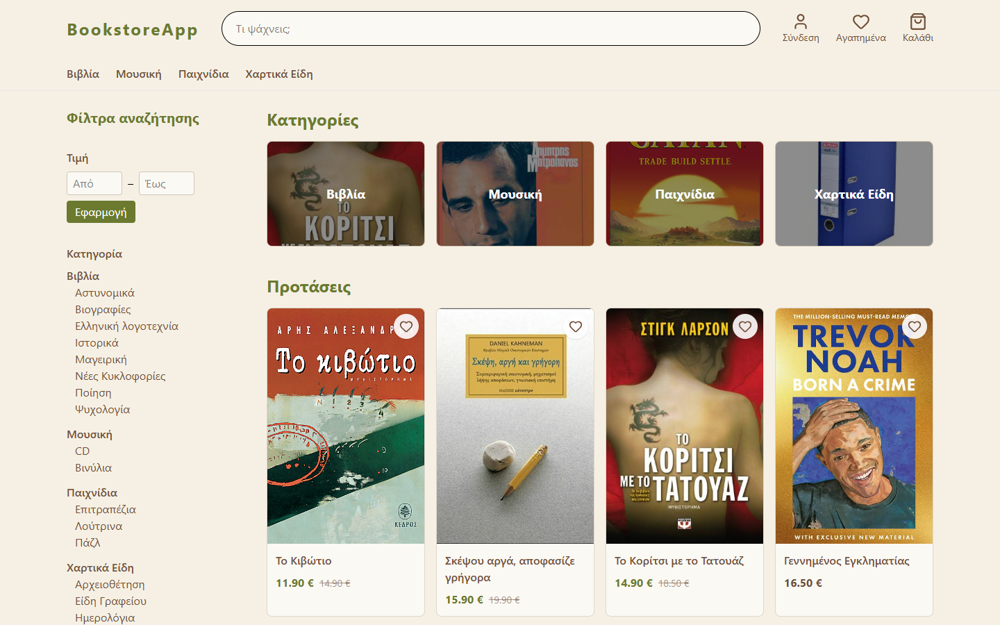
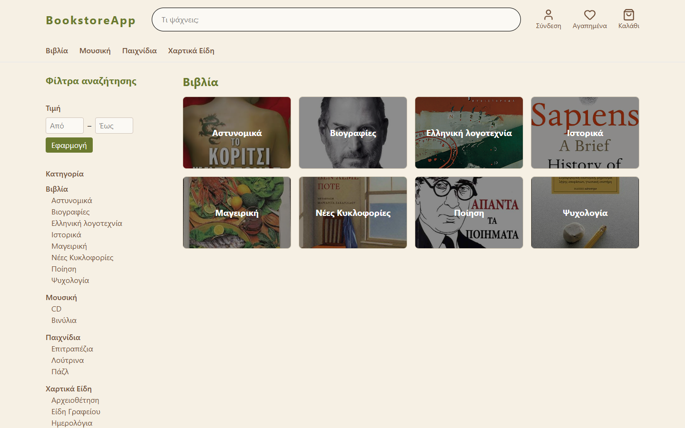
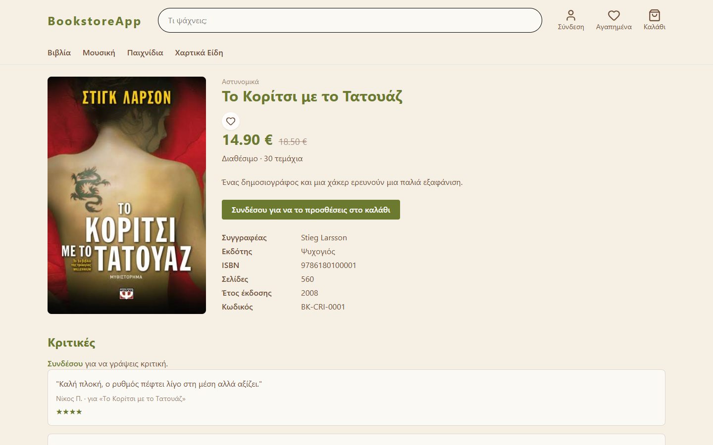
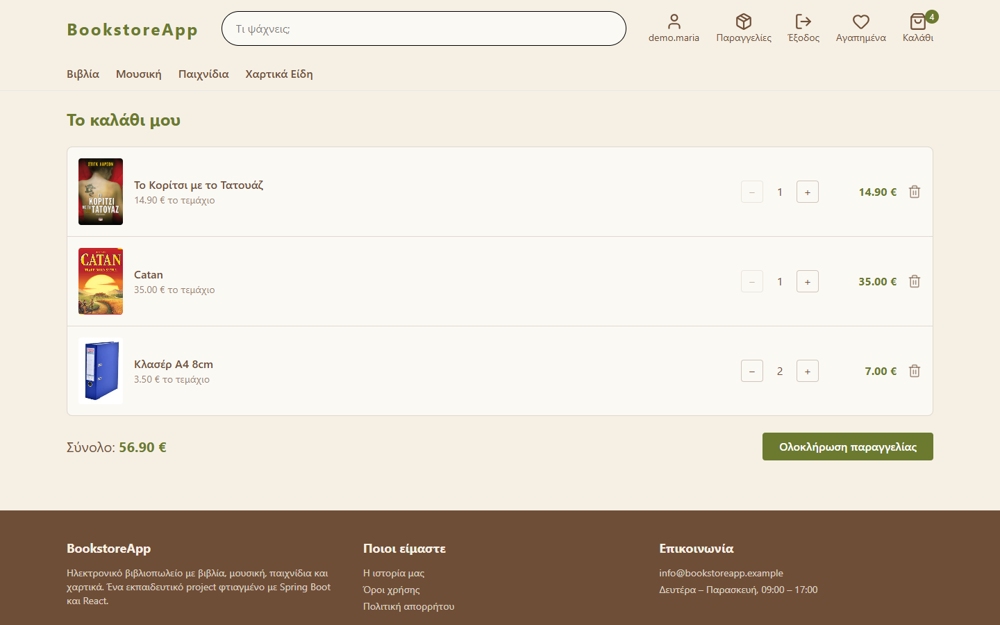
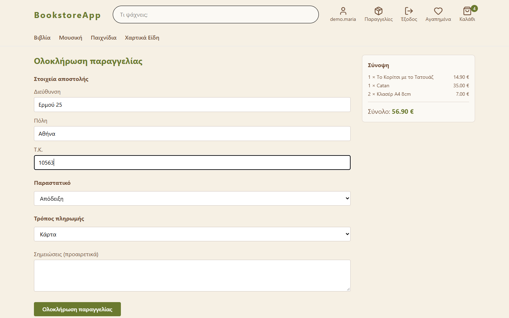
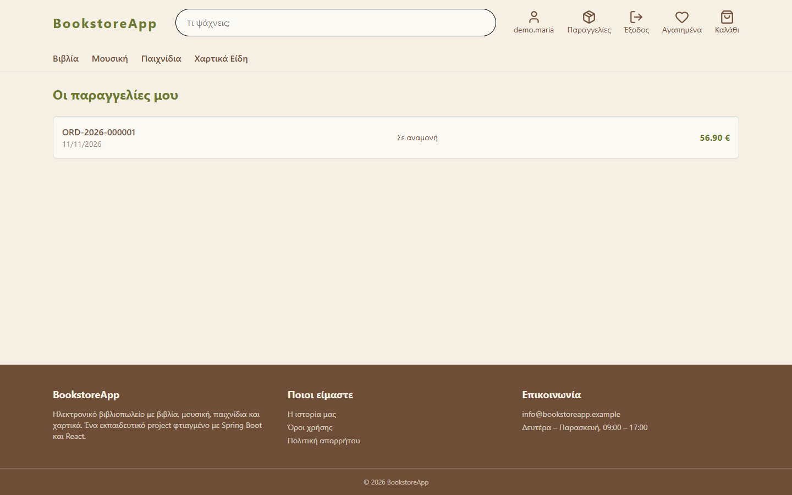
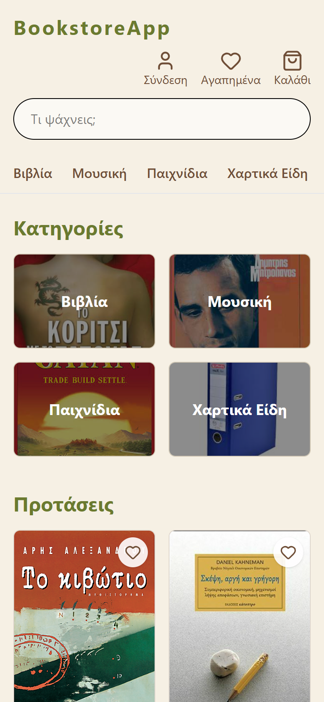

# Bookstore — E-shop Frontend

[](https://github.com/VasNera/bookstore-frontend/actions/workflows/ci.yml)

Single-page web app for an online store that sells **books, music, toys and stationery**, built with React and TypeScript. Customers browse and filter the catalogue, keep a cart, check out, follow their orders, write reviews and save favourites; an admin manages orders, products and categories.

It talks to the REST API in the companion repository **[VasNera/bookstore](https://github.com/VasNera/bookstore)** (Spring Boot, JWT, MySQL).



## Features

- **Catalogue**: category cards, a category menu with subcategories, a filters sidebar (price range, category), free-text search, sorting and pagination. The state lives in the URL, so every result page can be bookmarked and shared.
- **Product page**: details that change with the product type (ISBN and author for books, artist for music, age range for toys…), stock and availability, reviews.
- **Accounts**: register, log in, log out. The JWT is kept in `localStorage` and attached to every request; when it expires (401) the user is signed out automatically.
- **Cart**: server-side cart with quantity controls, a live item count in the header, and a total.
- **Checkout**: shipping details, receipt or invoice (the company fields only appear for an invoice), payment method, and field-level validation errors coming from the API.
- **Orders**: order history, order details with price snapshots, and cancellation while the order has not been shipped.
- **Favourites** and **reviews** (one review per user and product, star rating).
- **Profile**: edit personal details and change the password.
- **Admin panel** (role `ADMIN` only): list and filter all orders and move them through their lifecycle (only valid transitions are offered), manage products of all four types with a type-aware form, toggle the "featured" flag, delete products, and manage the category tree.
- **Responsive layout** and a 404 page.

<table>
  <tr>
    <td></td>
    <td></td>
  </tr>
  <tr>
    <td></td>
    <td></td>
  </tr>
  <tr>
    <td></td>
    <td></td>
  </tr>
</table>

## Tech stack

| | |
|---|---|
| UI | React 19, TypeScript |
| Build | Vite |
| Routing | TanStack Router (file-based routes, typed links and search params) |
| Server state | TanStack Query (caching, mutations, invalidation) |
| Styling | Tailwind CSS 4, lucide-react icons |
| Quality | ESLint, type-checked build (`tsc`), GitHub Actions |
| Delivery | Docker (multi-stage build, nginx) |

## How it is organised

```
src/
  api/         one function per endpoint (fetch wrapper in client.ts: base URL, JWT, error handling)
  auth/        auth context + provider (user, sign in / out, expiry handling)
  components/  reusable UI: Header, ProductCard, FiltersSidebar, ProductForm, ...
  hooks/       TanStack Query hooks (cart, favourites, categories)
  routes/      one file per page; the file name is the URL
  types/       TypeScript types that mirror the API's DTOs
  utils/       labels and order-status transitions
```

A few decisions worth knowing about:

- **Vertical slices**: each feature was built as type → API function → query/mutation hook → component → route, so the app was always working end to end.
- **Server state is not copied into component state.** TanStack Query owns it; mutations either write the response into the cache (cart) or invalidate the affected queries (orders, favourites, admin lists).
- **The URL is the state of the catalogue** (`/products?categoryId=3&minPrice=10&page=1`). Search params are parsed and validated in one place per route.
- **Errors keep their shape.** The API's `{ code, message, errors }` becomes an `ApiError`, so forms can show the message under the right field.
- **The UI never trusts itself for security.** Hiding the admin links is only convenience: every admin endpoint is protected by the backend (403).

## Run it

### With Docker (frontend + backend + database)

You need the backend running first, because the frontend calls its API.

```bash
# 1. backend: https://github.com/VasNera/bookstore
git clone https://github.com/VasNera/bookstore.git
cd bookstore
cp .env.example .env        # development values are included
docker compose up --build   # API on http://localhost:8080

# 2. frontend (in another terminal)
git clone https://github.com/VasNera/bookstore-frontend.git
cd bookstore-frontend
docker compose up --build   # app on http://localhost:5173
```

The backend seeds a demo catalogue (21 categories, 34 products) on its first start, and creates an `admin` account whose password is `ADMIN_PASSWORD` in the backend's `.env`. Register a normal account from the app to try the customer side.

The frontend image is a multi-stage build: Node compiles the app, and nginx serves the static files (with a fallback to `index.html` so client-side routes survive a refresh).

> The API address is baked into the bundle at build time (`VITE_API_URL`, set in `docker-compose.yml`). The backend only accepts requests from `http://localhost:5173`, so keep that port.

### Without Docker (development)

Requires Node 24.

```bash
npm ci
npm run dev        # http://localhost:5173
```

The dev server reads `VITE_API_URL` from `.env.development` (default `http://localhost:8080/api/v1`).

| Script | What it does |
|---|---|
| `npm run dev` | dev server with hot reload |
| `npm run lint` | ESLint |
| `npm run build` | type-check (`tsc`) and production build into `dist/` |
| `npm run preview` | serve the production build locally |

## Continuous integration

Every push to `main` and every pull request runs `npm ci`, `npm run lint` and `npm run build` on GitHub Actions (see `.github/workflows/ci.yml`).

## Notes

This is a learning and portfolio project, not a real shop: payments are simulated, and the book covers are only there to make the demo look like a real catalogue.
